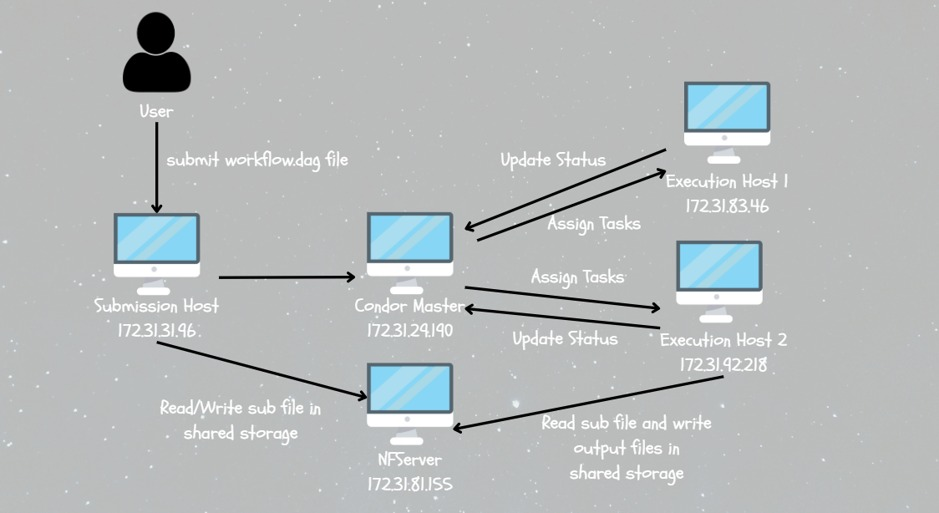
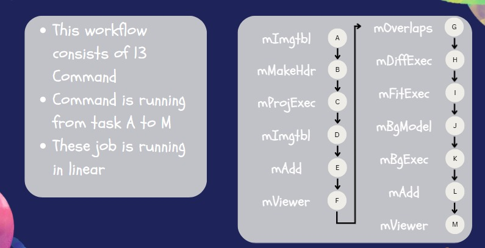
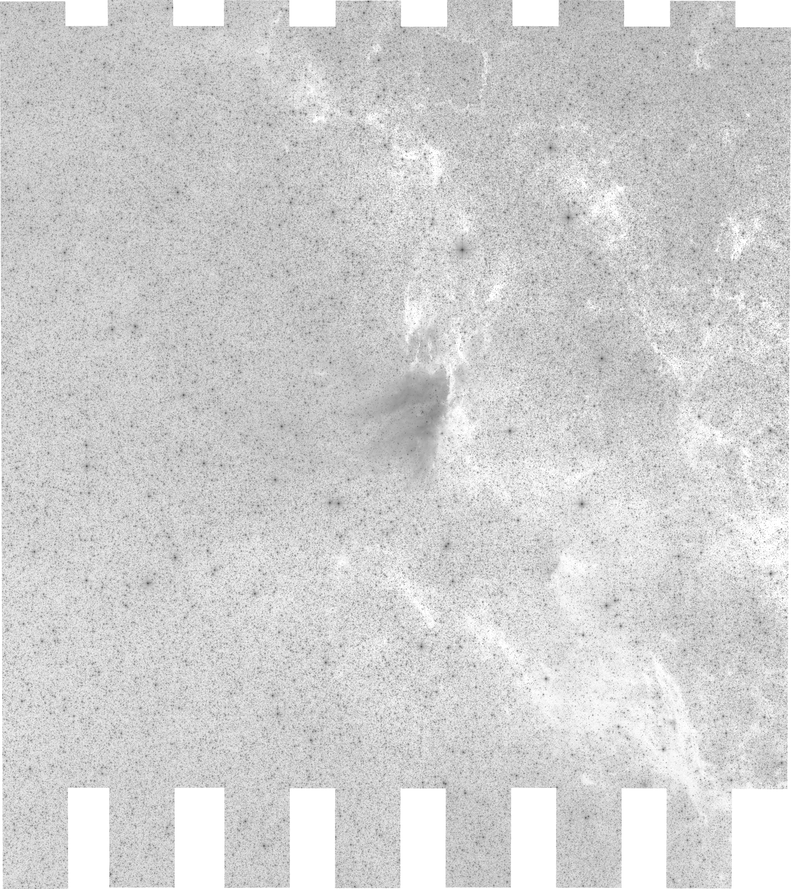

# nasa-montage-distributed-computing
Distributed astronomical image processing using NASA Montage, HTCondor and AWS EC2

# NASA Montage Distributed Computing Project

A distributed astronomical image processing project using **NASA Montage, HTCondor, DAGMan, AWS EC2, and NFS**.

This project demonstrates how distributed computing can be used to process astronomical images across multiple AWS EC2 instances. HTCondor manages job scheduling and execution, DAGMan controls job dependencies, and NFS provides shared storage between the machines.

---

## Table of Contents

- [Project Overview](#project-overview)
- [Technologies Used](#technologies-used)
- [System Architecture](#system-architecture)
- [AWS Infrastructure](#aws-infrastructure)
- [Montage Processing Workflow](#montage-processing-workflow)
- [HTCondor and DAGMan](#htcondor-and-dagman)
- [NFS Shared Storage](#nfs-shared-storage)
- [Project Structure](#project-structure)
- [Configuration and Execution](#configuration-and-execution)
- [Final Results](#final-results)
- [Challenges and Learning Outcomes](#challenges-and-learning-outcomes)

---

## Project Overview

The objective of this project is to implement a distributed computing environment to process astronomical images using the NASA Montage toolkit.

Instead of performing all image processing tasks on a single machine, the project uses HTCondor to manage and distribute computational jobs across multiple execution hosts.

DAGMan is used to define and manage the dependencies between 13 Montage processing tasks, while NFS provides a shared filesystem that allows the different machines to access common input files, intermediate files, and output files.

The project demonstrates the practical implementation of:

- Distributed job scheduling and execution.
- Multi-machine computing using AWS EC2.
- Workflow management using DAGMan.
- Shared storage using Network File System (NFS).
- Astronomical image reprojection and mosaic generation.
- Background correction and image combination.

## Technologies Used

| Technology | Purpose |
|---|---|
| AWS EC2 | Provides virtual machines for the distributed environment |
| Ubuntu Linux | Operating system for the EC2 instances |
| HTCondor | Distributed job scheduling and resource management |
| DAGMan | Manages job dependencies and workflow execution |
| NASA Montage | Astronomical image processing toolkit |
| NFS | Provides shared storage between machines |
| Linux Shell | Server configuration and command-line operations |

## System Architecture

The distributed environment consists of five AWS EC2 instances.



### Infrastructure Components

| Instance | Role | Responsibility |
|---|---|---|
| Submission Host | Submit Node | Submits Montage workflow jobs |
| Condor Master | Central Manager | Manages the HTCondor pool and job scheduling |
| Execution Host 1 | Worker Node | Executes assigned processing tasks |
| Execution Host 2 | Worker Node | Executes assigned processing tasks |
| NFS Server | Shared Storage | Stores shared input, intermediate, and output files |

### How the System Works

1. The user submits `workflow.dag` from the Submission Host.
2. DAGMan manages the execution order of the 13 Montage jobs.
3. HTCondor schedules eligible jobs across the execution hosts.
4. Execution hosts access shared files through the NFS-mounted directory.
5. Processing results are written to the shared storage.
6. The final astronomical mosaic is generated after all required processing stages are completed.

## AWS Infrastructure

The project uses five EC2 instances to establish the distributed computing environment.

HTCondor is installed with different roles:

- **Central Manager:** Configured using the Central Manager installation option.
- **Submission Host:** Configured as a Submit node.
- **Execution Hosts:** Configured as Execute nodes.

The Submission Host communicates with the Central Manager, which manages the HTCondor pool and coordinates job scheduling.

The execution hosts perform the assigned computational tasks.

## Montage Processing Workflow

The project uses 13 Montage commands, organized into two major processing phases.



### Phase 1: Initial Mosaic Generation

| Task | Montage Command | Description |
|---|---|---|
| A | mImgtbl | Creates an image metadata table from the input images |
| B | mMakeHdr | Generates the output mosaic header |
| C | mProjExec | Reprojects the input images |
| D | mImgtbl | Creates a metadata table for the reprojected images |
| E | mAdd | Combines the reprojected images into an initial mosaic |
| F | mViewer | Generates a visualization of the initial mosaic |

**Initial output:** `m17_uncorrected.fits` and `m17_uncorrected.png`

### Phase 2: Background Correction

| Task | Montage Command | Description |
|---|---|---|
| G | mOverlaps | Identifies overlapping image pairs |
| H | mDiffExec | Calculates differences between overlapping images |
| I | mFitExec | Fits background differences |
| J | mBgModel | Generates background correction parameters |
| K | mBgExec | Applies background corrections |
| L | mAdd | Combines corrected images into the final mosaic |
| M | mViewer | Generates the final mosaic visualization |

**Final output:** `m17_mosaic.fits` and `m17_mosaic.png`

The workflow first generates an initial mosaic, then performs background correction before generating the final astronomical image.

## HTCondor and DAGMan

HTCondor is responsible for distributing computational jobs across the available execution hosts.

DAGMan (Directed Acyclic Graph Manager) manages the dependencies between the 13 jobs.

The workflow is defined in `workflow.dag`.

Example:

```text
JOB A task_a.sub
JOB B task_b.sub
JOB C task_c.sub

PARENT A CHILD B
PARENT B CHILD C
```

The actual project contains all 13 jobs, from A to M, connected sequentially.

Each `.sub` file defines the executable, arguments, output, error, log, and working directory for its corresponding Montage task.

The submission files are located in:

```text
dagman/submit-files/
```

## NFS Shared Storage

Network File System (NFS) is used to provide shared storage between the Submission Host and Execution Hosts.

The NFS Server provides a shared directory that is mounted on the other machines.

The shared storage is important because the HTCondor submission files use:

```text
should_transfer_files = NO
```

Therefore, the required executables and processing files must be accessible through the shared filesystem.

The shared directory used in the project is:

```text
/mnt/data
```

The NFS Server exports the shared directory, allowing the other machines to access common project files.

## Project Structure

```text
nasa-montage-distributed-computing/
│
├── README.md
│
├── dagman/
│   ├── workflow.dag
│   └── submit-files/
│       ├── task_a.sub
│       ├── task_b.sub
│       ├── task_c.sub
│       ├── task_d.sub
│       ├── task_e.sub
│       ├── task_f.sub
│       ├── task_g.sub
│       ├── task_h.sub
│       ├── task_i.sub
│       ├── task_j.sub
│       ├── task_k.sub
│       ├── task_l.sub
│       └── task_m.sub
│
├── diagrams/
│   ├── aws-architecture.png
│   └── montage-workflow.png
│
├── docs/
│   ├── aws-architecture.md
│   ├── htcondor-installation.md
│   ├── nfs-configuration.md
│   └── montage-workflow.md
│
├── results/
│   └── m17_mosaic.png
│
└── .gitignore
```

## Configuration and Execution

### Prerequisites

- Ubuntu Linux EC2 instances.
- AWS EC2 access.
- HTCondor installed and configured.
- NASA Montage installed.
- NFS Server and NFS clients configured.
- Shared storage mounted at `/mnt/data`.

### Execution

1. Ensure all HTCondor nodes are connected to the pool.
2. Verify that the NFS shared directory is mounted.
3. Ensure the Montage executables are accessible.
4. Place the input astronomical images in the required input directory.
5. Navigate to the directory containing `workflow.dag`.
6. Submit the workflow using:

```bash
condor_submit_dag workflow.dag
```

7. Monitor job execution using:

```bash
condor_q
```

8. Check the HTCondor pool status using:

```bash
condor_status
```

**Important:** The original submission files currently use absolute paths such as `/mnt/data/Montage/bin` and `/mnt/data/assignment`. These paths must be adapted to the deployment environment before reusing the workflow.

## Final Results

The final output is an astronomical mosaic generated after image reprojection, overlap analysis, background correction, and image combination.

### Final Montage Output



Output files:

- `m17_mosaic.fits` – Final astronomical mosaic in FITS format.
- `m17_mosaic.png` – Final visualization generated using `mViewer`.

## Challenges and Learning Outcomes

Through this project, I gained practical experience in:

- Deploying a distributed computing environment using AWS EC2.
- Configuring an HTCondor pool with a Central Manager, Submission Host, and Execution Hosts.
- Understanding distributed job scheduling and resource allocation.
- Managing task dependencies using DAGMan.
- Configuring NFS shared storage across multiple virtual machines.
- Understanding Linux permissions and shared directory access.
- Implementing an astronomical image processing workflow using NASA Montage.
- Managing multi-stage computational workflows.

---

## Disclaimer

This repository documents an academic distributed computing project. Configuration files and deployment instructions may require modifications depending on the operating system, HTCondor version, network configuration, and filesystem paths.

